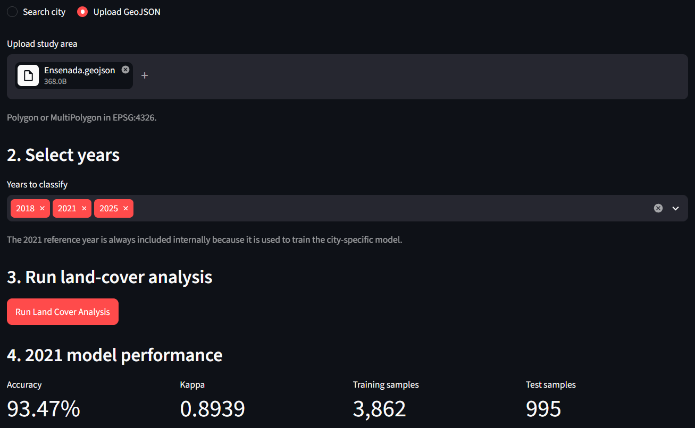
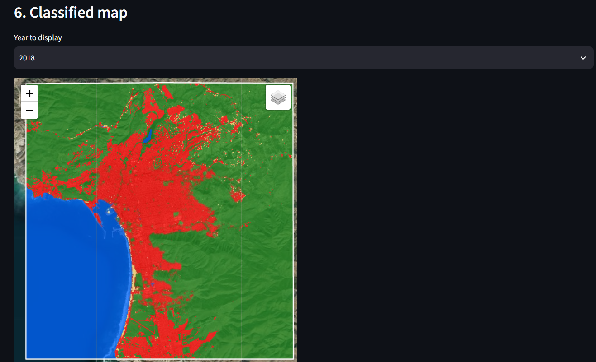
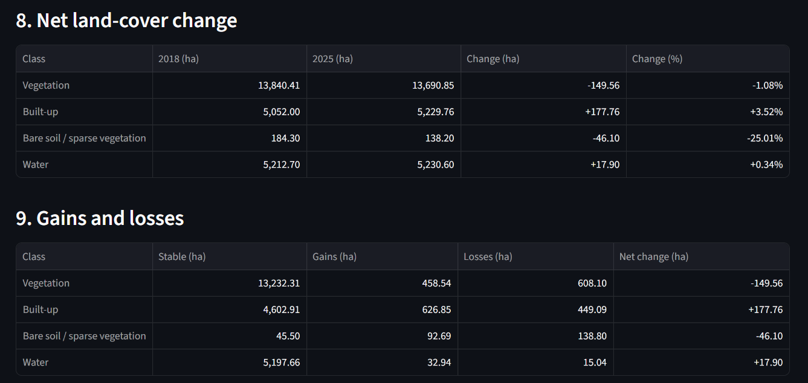
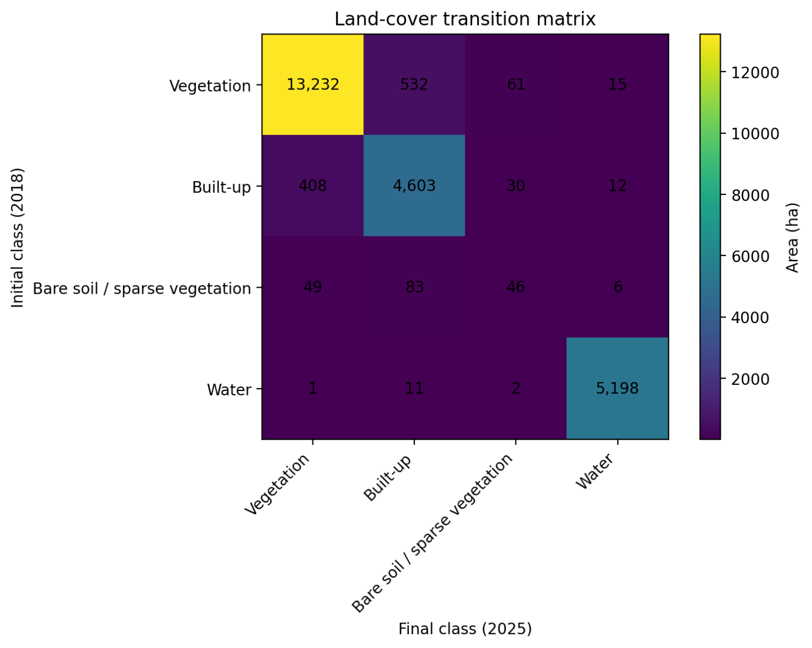
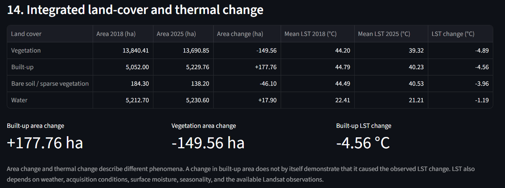

# Urban Earth Observation

A geospatial machine learning application for **city-specific land-cover classification, multitemporal change detection, and land surface temperature analysis** using satellite imagery and Google Earth Engine.

The project integrates **Sentinel-2, SRTM, ESA WorldCover, Landsat 8/9, Random Forest, Python, and Streamlit** into an interactive workflow that can be applied to different study areas in Mexico.

The methodology is inspired by my Master's research on multispectral land-cover classification and was extended into an interactive and reusable geospatial analysis application.

---

## Project Overview

Urban Earth Observation analyzes how land-cover patterns evolve through time and how those changes relate to surface temperature.

Instead of using a single model for every location, the application trains a **separate Random Forest model for each study area**.

For each new study area:

1. A Random Forest model is trained using 2021 reference data.
2. The trained city-specific classifier is cached during the Streamlit session.
3. The same classifier is reused to classify the selected years.
4. Land-cover areas and transitions are calculated.
5. Landsat-derived Land Surface Temperature (LST) is analyzed by predicted land-cover class.
6. Land-cover and thermal changes are integrated into a common analytical summary.

This design preserves local spectral characteristics instead of assuming that one classifier can adequately represent every city.

---

## Key Features

- City-specific Random Forest classification
- Dynamic study-area selection
- Mexican city search
- Custom GeoJSON support
- Sentinel-2 multispectral preprocessing
- Spectral-index calculation
- SRTM elevation and slope integration
- ESA WorldCover reference labels
- Multiyear land-cover inference
- Land-cover area statistics
- Net change analysis
- Gains and losses analysis
- Land-cover transition matrices
- Interactive Folium maps
- Landsat 8/9 Land Surface Temperature analysis
- Temperature statistics by land-cover class
- Multiyear thermal comparison
- Integrated land-cover and thermal change analysis
- GeoTIFF export through Google Earth Engine
- Streamlit interactive interface

---

---

## Application Preview

### City-Specific Model Evaluation



The application trains a separate 2021 Random Forest model for each study area and reports its validation metrics before temporal inference.

### Multiyear Land-Cover Classification



Interactive land-cover maps allow users to inspect classified surfaces for each selected year.

### Land-Cover Change Analysis



Area statistics quantify changes in vegetation, built-up surfaces, bare soil / sparse vegetation, and water.

### Land-Cover Transition Matrix



Transition analysis identifies both stable areas and conversions between land-cover classes.

### Thermal Analysis



Landsat-derived Land Surface Temperature is analyzed by predicted land-cover class and integrated with multiyear land-cover change statistics.

---

## System Architecture

```text
Study Area
    │
    ├── City search + radius
    │
    └── Custom GeoJSON
    │
    ▼
2021 Training Dataset
    │
    ├── Sentinel-2
    │   ├── B2
    │   ├── B3
    │   ├── B4
    │   ├── B8
    │   ├── B11
    │   └── B12
    │
    ├── Spectral Indices
    │   ├── NDVI
    │   ├── NDBI
    │   ├── MNDWI
    │   └── BSI
    │
    ├── SRTM
    │   ├── Elevation
    │   └── Slope
    │
    └── ESA WorldCover 2021
            │
            ▼
      Random Sampling
        5,000 pixels
            │
            ▼
        80 / 20 Split
            │
            ▼
      Random Forest
       100 trees
            │
            ▼
     City-Specific Model
            │
            ▼
 June–July Multiyear Inference
            │
            ├── Classified maps
            ├── Area statistics
            ├── Change detection
            ├── Gains and losses
            └── Transition matrix
            │
            ▼
       Landsat 8 / 9
            │
            ▼
           LST
            │
            ▼
 Thermal Analysis by Land Cover
            │
            ▼
Integrated Land-Cover + Thermal Analysis
```

---

# Methodology

## 1. Study Area

The application supports two methods for defining the study area.

### City Search

Users can search for a city and state in Mexico and define a circular analysis radius.

The city-search workflow uses the geographic coordinates returned by the search service and generates a circular study area around the selected location.

This provides a convenient way to explore cities without requiring external GIS files.

The resulting circular region should be interpreted as an **analytical study area**, not as an official administrative or urban boundary.

### GeoJSON Upload

Users can upload a custom study area as a GeoJSON file.

Supported geometries include:

- Polygon
- MultiPolygon

The expected coordinate reference system is:

```text
EPSG:4326
```

This option is useful when an exact study boundary is already available.

---

## 2. Sentinel-2 Preprocessing

Multispectral imagery is obtained from the Google Earth Engine collection:

```text
COPERNICUS/S2_SR_HARMONIZED
```

The following Sentinel-2 spectral bands are used:

| Band | Description | Native Resolution |
|---|---|---:|
| B2 | Blue | 10 m |
| B3 | Green | 10 m |
| B4 | Red | 10 m |
| B8 | Near Infrared | 10 m |
| B11 | Shortwave Infrared 1 | 20 m |
| B12 | Shortwave Infrared 2 | 20 m |

Images are filtered according to:

- study area;
- analysis period;
- cloud percentage.

The current workflow uses a maximum scene cloud threshold of approximately:

```text
10%
```

Cloud-contaminated pixels are masked before generating the composite.

Surface reflectance values are scaled to reflectance units and a **median composite** is generated for each analysis period.

The project uses a common **10 m working grid** for analysis.

However, resampling a dataset to a 10 m grid does not create new native spatial information. For example, Sentinel-2 B11 and B12 remain fundamentally 20 m observations even when evaluated on the common grid.

---

## 3. Spectral Indices

Four spectral indices are calculated from the Sentinel-2 imagery and included as machine-learning predictors.

### NDVI — Normalized Difference Vegetation Index

NDVI is calculated using the near-infrared and red bands.

```text
NDVI = (B8 - B4) / (B8 + B4)
```

It provides information about vegetation presence and photosynthetic activity.

---

### NDBI — Normalized Difference Built-up Index

NDBI is calculated using shortwave infrared and near-infrared reflectance.

```text
NDBI = (B11 - B8) / (B11 + B8)
```

It provides information related to built-up and impervious surfaces.

---

### MNDWI — Modified Normalized Difference Water Index

MNDWI is calculated using the green and shortwave-infrared bands.

```text
MNDWI = (B3 - B11) / (B3 + B11)
```

It is used to improve the discrimination of water surfaces.

---

### BSI — Bare Soil Index

BSI combines visible, near-infrared, and shortwave-infrared information.

It provides information associated with:

- exposed soil;
- sparsely vegetated surfaces;
- dry land-cover conditions.

These spectral indices complement the original Sentinel-2 bands by describing surface properties that may not be represented as directly by individual spectral bands.

---

## 4. Topographic Variables

Topographic information is obtained from the Shuttle Radar Topography Mission dataset:

```text
USGS/SRTMGL1_003
```

Two variables are included in the predictor stack:

- Elevation
- Slope

Elevation is obtained directly from the SRTM Digital Elevation Model.

Slope is calculated from the elevation surface using Google Earth Engine terrain functions.

SRTM has a native spatial resolution of approximately 30 m.

The variables are evaluated on the project's common 10 m working grid, but this resampling does **not** create native 10 m topographic information.

---

## 5. Predictor Stack

The final Random Forest model uses **12 predictor variables**.

### Sentinel-2 spectral bands

```text
B2
B3
B4
B8
B11
B12
```

### Spectral indices

```text
NDVI
NDBI
MNDWI
BSI
```

### Topographic variables

```text
Elevation
Slope
```

Therefore, the complete predictor stack is:

```text
B2
B3
B4
B8
B11
B12
NDVI
NDBI
MNDWI
BSI
Elevation
Slope
```

This combination integrates:

- multispectral information;
- vegetation characteristics;
- built-up surface information;
- water information;
- bare-soil characteristics;
- terrain information.

---

## 6. Reference Land-Cover Labels

Training labels are obtained from:

```text
ESA/WorldCover/v200
```

ESA WorldCover 2021 provides the reference land-cover information used to build the training dataset.

The original WorldCover classes are reclassified into four broader categories.

| Class | Land Cover |
|---:|---|
| 1 | Vegetation |
| 2 | Built-up |
| 3 | Bare soil / sparse vegetation |
| 4 | Water |

### Vegetation

The following ESA WorldCover classes are grouped into the vegetation category:

```text
10
20
30
40
90
95
100
```

These include several types of tree cover, shrubland, grassland, cropland, wetlands, mangroves, and related vegetated surfaces.

### Built-up

```text
50
```

### Bare soil / sparse vegetation

```text
60
```

### Water

```text
80
```

Snow and ice are excluded from the four-class system.

ESA WorldCover is used as a **reference-label dataset**.

Therefore, classification accuracy in this project represents agreement with the WorldCover-derived reference labels rather than validation against independent field observations.

---

## 7. City-Specific Training Dataset

A separate training dataset is generated for every new study area.

The training reference year is:

```text
2021
```

The model-training period is:

```text
2021-03-01
to
2021-06-01
```

Because Google Earth Engine uses an exclusive ending date, this period effectively represents:

```text
March–May 2021
```

The training process combines:

```text
Sentinel-2 bands
+
Spectral indices
+
SRTM variables
+
ESA WorldCover labels
```

The combined image is sampled using the following configuration:

```text
Requested pixels: 5,000
Working scale: 10 m
Random seed: 42
```

Sampling is performed randomly across the study area.

The workflow does **not** use a fixed number of samples per class.

As a result, the final dataset reflects the class distribution present within the study area and may be imbalanced.

A deterministic random column is added to the sampled observations and is later used for the train/test split.

---

## 8. Random Forest Classification

The machine-learning classifier used in the project is:

```text
Google Earth Engine smileRandomForest
```

The sampled dataset is divided into:

```text
80% training
20% testing
```

The split is generated using the deterministic random column created during sampling.

The Random Forest configuration is:

```text
Number of trees: 100
Random seed: 42
Number of land-cover classes: 4
Number of predictors: 12
```

The classifier learns the relationship between the predictor stack and the WorldCover-derived land-cover labels.

A **separate Random Forest is trained for every new study area**.

The project therefore does not assume that one model trained in one city can automatically generalize to all other cities.

Within the Streamlit session, once the model for a study area has been trained, the classifier is cached and reused when the user requests additional inference years for that same area.

---

## 9. Temporal Inference

After the city-specific 2021 model is trained, the same classifier is reused to classify other years.

The temporal inference period is:

```text
June 1
to
August 1
```

Because the ending date is exclusive, this corresponds to:

```text
June–July
```

This inference window is used for **all classified years**, including 2021.

For example:

```text
2018 → June–July 2018
2021 → June–July 2021
2025 → June–July 2025
```

The methodology therefore intentionally separates the model-training period from the temporal-inference period.

```text
TRAINING

March–May 2021
      │
      ▼
Random Forest
      │
      ▼
City-specific classifier
```

```text
INFERENCE

June–July 2018
June–July 2021
June–July 2025
...
      │
      ▼
Multiyear land-cover maps
```

This design allows a classifier trained from the 2021 reference dataset to be applied consistently across the selected temporal series.

However, the seasonal difference between training and inference periods must be considered when interpreting the results.

Phenological conditions, soil moisture, vegetation condition, and other seasonal characteristics may differ between March–May and June–July.

---

# Land-Cover Change Analysis

For every classified year, the application calculates the area occupied by each land-cover class.

Area is calculated in:

```text
hectares
```

For multiyear analyses, the application generates:

- land-cover area by year;
- temporal trends;
- net change;
- percentage change;
- stable area;
- gross gains;
- gross losses;
- transition matrices.

---

## Net Land-Cover Change

For each class, the application compares the first and final analyzed years.

The following statistics are reported:

```text
Initial area
Final area
Area change
Percentage change
```

This makes it possible to quantify whether a class increased or decreased during the analyzed period.

---

## Gains and Losses

The application also separates change into:

```text
Stable area
Gross gains
Gross losses
Net change
```

This provides additional information that cannot be obtained from net change alone.

For example, a land-cover class may experience both substantial gains and substantial losses while showing only a small final net change.

---

## Transition Matrix

The transition matrix quantifies the amount of land converted from each initial class into every final class.

Conceptually:

```text
                Final class

Initial       Vegetation   Built-up   Bare   Water

Vegetation        ...
Built-up          ...
Bare              ...
Water             ...
```

The diagonal represents stable areas.

Off-diagonal values represent land-cover transitions between classes.

---

## Example Land-Cover Results

One example study-area run produced:

| Land Cover | 2018 Area (ha) | 2025 Area (ha) | Change (ha) |
|---|---:|---:|---:|
| Vegetation | 22,901.89 | 18,784.54 | -4,117.35 |
| Built-up | 14,447.06 | 16,175.27 | +1,728.21 |
| Bare soil / sparse vegetation | 3,112.77 | 5,437.74 | +2,324.97 |
| Water | 134.18 | 198.36 | +64.18 |

These values are included as an example of the analytical output and should not be generalized to other locations.

---

# Land Surface Temperature

Land Surface Temperature is derived from Landsat Collection 2 Level 2 imagery.

The project uses:

```text
LANDSAT/LC08/C02/T1_L2
LANDSAT/LC09/C02/T1_L2
```

corresponding to:

- Landsat 8
- Landsat 9

Only Level-2 Surface Temperature products are used.

The thermal information is obtained from:

```text
ST_B10
```

The Landsat scaling parameters are applied to convert the original values into temperature.

The resulting values are converted from Kelvin to:

```text
degrees Celsius
```

Quality masking is applied using the Landsat QA information before generating the thermal composite.

---

## Thermal Analysis Period

The LST workflow uses the same temporal window as land-cover inference:

```text
June–July
```

This allows the thermal observations and predicted land-cover maps to represent comparable seasonal periods.

---

## Thermal Analysis by Land Cover

The predicted land-cover raster is combined with the Landsat LST composite.

For every predicted class, the application calculates:

```text
Mean LST
Median LST
Minimum LST
Maximum LST
Valid pixel count
```

The analysis is performed for:

```text
Vegetation
Built-up
Bare soil / sparse vegetation
Water
```

This allows the thermal behavior of different predicted surface types to be compared.

---

## Multiyear Thermal Analysis

The application can repeat the LST analysis across all classified years.

For every year and class it calculates:

- mean LST;
- median LST;
- thermal difference relative to vegetation;
- number of available Landsat observations.

This makes it possible to explore how thermal characteristics vary through time.

---

## Example Thermal Results

Example mean LST values from one study-area analysis:

| Year | Vegetation | Built-up | Bare / Sparse | Water |
|---:|---:|---:|---:|---:|
| 2018 | 57.17 °C | 55.64 °C | 59.54 °C | 55.67 °C |
| 2021 | 56.95 °C | 54.01 °C | 58.33 °C | 53.13 °C |
| 2025 | 54.57 °C | 52.78 °C | 57.18 °C | 51.61 °C |

These values represent one specific study area and seasonal sampling configuration.

They should not be interpreted as universal thermal characteristics for these land-cover classes.

---

# Integrated Land-Cover and Thermal Change

The application combines land-cover change statistics with thermal information.

For each land-cover class, the first and final analyzed years are compared.

The integrated output includes:

```text
Initial area
Final area
Area change
Initial mean LST
Final mean LST
LST change
```

This allows spatial change and thermal change to be inspected within the same analytical framework.

For example, the application can simultaneously show:

```text
Built-up area change
Vegetation area change
Built-up mean LST change
```

However, land-cover and thermal change describe different phenomena.

A change in land-cover area does not by itself demonstrate that it caused a corresponding temperature change.

Land Surface Temperature is also affected by:

- meteorological conditions;
- soil moisture;
- vegetation condition;
- atmospheric conditions;
- image acquisition dates;
- seasonal variability;
- number of available cloud-free Landsat observations.

The integrated analysis should therefore be interpreted as an exploratory remote-sensing comparison rather than a direct causal analysis.

---

# Model Evaluation

The city-specific Random Forest model is evaluated using the 20% test partition.

The application reports:

```text
Overall Accuracy
Cohen's Kappa
4 × 4 Confusion Matrix
```

An example model run produced:

```text
Training samples: 4,021
Test samples: 979

Overall Accuracy: 83.96%
Kappa: 0.6903
```

Example confusion matrix:

```text
                         Predicted
Actual             Veg   Built   Bare   Water

Vegetation          527     30      9       1
Built-up             51    279      1       0
Bare / Sparse        36     27     11       0
Water                 2      0      0       5
```

The random sampling methodology can produce class imbalance.

In this example, the test partition contained substantially more vegetation and built-up observations than water observations.

Therefore, overall accuracy should not be interpreted independently from:

- the confusion matrix;
- class distribution;
- number of validation observations per class.

---

# Interactive Application

The project includes a Streamlit interface that integrates the complete workflow.

The application allows the user to:

1. Select a study area.
2. Search for a city or upload GeoJSON.
3. Select inference years.
4. Train or reuse the city-specific model.
5. Generate multiyear land-cover classifications.
6. Inspect model accuracy.
7. Explore interactive classified maps.
8. Analyze land-cover areas.
9. Analyze gains and losses.
10. Inspect transition matrices.
11. Export classified GeoTIFFs.
12. Calculate LST by land-cover class.
13. Compare thermal behavior through time.
14. Analyze integrated land-cover and thermal change.

---

# Application Architecture

The Streamlit application is separated into dedicated modules.

```text
app/
│
├── streamlit_app.py
│
├── analysis_controller.py
│
├── map_utils.py
│
├── table_utils.py
│
└── pages/
    └── 1_Land_Cover.py
```

### `analysis_controller.py`

Controls:

- study-area construction;
- model caching;
- model training;
- inference execution;
- change statistics;
- Streamlit analysis state.

### `map_utils.py`

Handles:

- Folium basemap generation;
- Earth Engine tile layers;
- land-cover maps;
- LST maps;
- study-area boundaries.

### `table_utils.py`

Builds the DataFrames used by the interface for:

- confusion matrices;
- land-cover areas;
- change statistics;
- gains and losses;
- thermal statistics;
- integrated analysis.

This separation keeps visualization and interface logic independent from the geospatial and machine-learning workflow.

---

# GeoTIFF Export

Classified maps can be exported from Google Earth Engine to Google Drive.

The exported classification uses:

```text
Class 1 → Vegetation
Class 2 → Built-up
Class 3 → Bare soil / sparse vegetation
Class 4 → Water
NoData → 0
```

The export uses the Sentinel-2 reference grid to preserve alignment with the classification workflow.

---

# Project Structure

```text
urban-earth-observation/
│
├── app/
│   ├── analysis_controller.py
│   ├── map_utils.py
│   ├── streamlit_app.py
│   ├── table_utils.py
│   └── pages/
│       └── 1_Land_Cover.py
│
├── data/
│   └── study_area.geojson
│
├── experiments/
│   ├── sentinel1.py
│   ├── spatial_validation.py
│   ├── test_compare_predictors.py
│   ├── test_sentinel1.py
│   └── test_spatial_validation.py
│
├── src/
│   ├── __init__.py
│   ├── city_analysis.py
│   ├── city_search.py
│   ├── config.py
│   ├── exports.py
│   ├── landcover_labels.py
│   ├── landcover_map.py
│   ├── landcover_model.py
│   ├── landcover_statistics.py
│   ├── lst.py
│   ├── predictors.py
│   ├── sentinel2.py
│   ├── study_area.py
│   ├── thermal_landcover.py
│   └── training_data.py
│
├── tests/
│   ├── __init__.py
│   ├── test_city_pipeline.py
│   ├── test_city_search.py
│   ├── test_landcover_map.py
│   ├── test_landcover_model.py
│   ├── test_multiyear_thermal.py
│   ├── test_sentinel2.py
│   ├── test_thermal_landcover.py
│   ├── test_training_data.py
│   └── test_worldcover.py
│
├── .gitignore
├── README.md
└── requirements.txt
```

---

# Installation

## 1. Clone the repository

```bash
git clone https://github.com/FranciscOrtiz33/urban-earth-observation.git
cd urban-earth-observation
```

---

## 2. Create a Python environment

Using Conda:

```bash
conda create -n urban-earth python=3.11
conda activate urban-earth
```

Alternatively, a standard Python virtual environment can be used.

---

## 3. Install dependencies

```bash
pip install -r requirements.txt
```

The main dependencies are:

```text
earthengine-api
streamlit
folium
streamlit-folium
geopy
pandas
matplotlib
```

---

# Google Earth Engine Setup

The project requires access to Google Earth Engine.

A Google Cloud project with Earth Engine enabled is required.

Authenticate before running the application:

```bash
earthengine authenticate
```

The project must then be initialized using a valid Earth Engine-enabled Google Cloud project ID.

The repository currently contains the project configuration used during development.

Users running their own copy should configure their own Earth Engine project ID.

---

# Running the Application

From the repository root:

```bash
python -m streamlit run app/streamlit_app.py
```

Streamlit will launch the application in the local browser.

---

# Running Tests

Tests are executed as Python modules from the repository root.

Examples:

```bash
python -m tests.test_city_pipeline
python -m tests.test_landcover_map
python -m tests.test_landcover_model
python -m tests.test_training_data
python -m tests.test_thermal_landcover
python -m tests.test_multiyear_thermal
```

These tests interact with Google Earth Engine.

Therefore, they require:

- Earth Engine authentication;
- an Earth Engine-enabled Cloud project;
- internet access.

---

# Data Sources

| Dataset | Purpose |
|---|---|
| Sentinel-2 Surface Reflectance Harmonized | Spectral predictors |
| ESA WorldCover 2021 | Reference land-cover labels |
| SRTM | Elevation and slope |
| Landsat 8 Collection 2 Level 2 | Land Surface Temperature |
| Landsat 9 Collection 2 Level 2 | Land Surface Temperature |

Most remote-sensing processing is performed through Google Earth Engine.

---

# Experimental Work

The repository includes an `experiments/` directory containing approaches explored during development but not included in the final production workflow.

---

## Sentinel-1 Experiment

Sentinel-1 Synthetic Aperture Radar predictors were evaluated using:

```text
VV
VH
```

A comparison was performed between:

```text
12 predictors
Sentinel-2 + indices + SRTM
```

and:

```text
14 predictors
Sentinel-2 + indices + SRTM + Sentinel-1
```

The radar predictors produced only a limited overall improvement and did not consistently improve every land-cover class.

For this reason, Sentinel-1 was not incorporated into the official workflow.

The experiment is preserved in the repository for methodological transparency.

---

## Spatial Validation Experiment

A spatially separated validation strategy was also explored.

Spatial validation can provide a more conservative estimate of geographic generalization because nearby training and testing observations can otherwise share similar spatial characteristics.

However, the production workflow retains the random 80/20 split to remain consistent with the thesis-inspired methodology.

The spatial-validation implementation remains available as experimental work.

---

# Scientific Limitations

The project includes several methodological considerations that should be taken into account when interpreting the results.

---

## Reference Labels

ESA WorldCover 2021 is used as the training reference.

Therefore, classification performance represents agreement with WorldCover-derived labels rather than independent field-based ground truth.

---

## Class Imbalance

Sampling is random rather than class-balanced.

Consequently, common land-cover classes may contain many more training and testing observations than rare classes.

Evaluation metrics for minority classes should therefore be interpreted cautiously.

---

## Spatial Autocorrelation

The production model uses a random 80/20 split.

Training and testing observations may be geographically close to each other.

Because nearby pixels can share similar environmental and spectral characteristics, random validation may produce more optimistic performance estimates than geographically independent validation.

---

## Temporal Transferability

Each classifier is trained using 2021 observations and then reused for other years.

This assumes that the relationship between predictor variables and land-cover classes remains sufficiently transferable across time.

Changes in:

- atmospheric conditions;
- sensor observations;
- vegetation condition;
- soil moisture;
- urban materials;

can affect temporal transferability.

---

## Seasonal Difference

The model is trained using:

```text
March–May 2021
```

while temporal inference uses:

```text
June–July
```

Seasonal differences can affect spectral characteristics.

For example:

- vegetation phenology;
- soil moisture;
- crop cycles;
- water extent;

may differ between the training and inference periods.

---

## Spatial Resolution

The workflow uses a common 10 m analytical grid.

However, not every source dataset has native 10 m spatial resolution.

Examples:

```text
Sentinel-2 B2/B3/B4/B8 → 10 m
Sentinel-2 B11/B12 → 20 m
SRTM → approximately 30 m
Landsat thermal data → substantially coarser than 10 m
```

Resampling allows the datasets to be evaluated on a common grid but does not create additional native spatial information.

---

## Land Surface Temperature Interpretation

Differences in LST between years should not automatically be interpreted as:

- climatic trends;
- direct consequences of urban growth;
- direct consequences of vegetation loss.

Land Surface Temperature is affected by multiple factors, including:

- weather;
- atmospheric conditions;
- soil moisture;
- vegetation condition;
- acquisition date;
- seasonal variability;
- surface materials;
- number of available observations.

The thermal analysis is therefore best interpreted as an exploratory remote-sensing analysis.

---

## Study-Area Definition

The city-search functionality generates a circular buffer around the selected location.

This region is useful for exploratory analysis but does not necessarily correspond to:

- official city boundaries;
- municipal boundaries;
- metropolitan boundaries;
- urbanized-area boundaries.

Users requiring exact spatial definitions should upload a custom GeoJSON.

---

# Technologies

The project integrates tools and concepts from Data Science, Geospatial Analytics, and Remote Sensing.

```text
Python
Google Earth Engine
Streamlit
Folium
Pandas
Matplotlib
Geopy
Random Forest
Machine Learning
Remote Sensing
Geospatial Analysis
Sentinel-2
Landsat 8/9
SRTM
ESA WorldCover
GeoJSON
Git
GitHub
```

---

# Research Context

This project evolved from a Master's research workflow focused on:

> **Land-cover classification using machine learning and multispectral imagery**

The original research methodology was transformed into a reusable software application capable of analyzing additional study areas and temporal periods.

The project demonstrates the integration of:

```text
Remote sensing
Geospatial data processing
Machine learning
Temporal analysis
Data visualization
Earth observation
Interactive application development
```

It also demonstrates the transformation of a research methodology into a structured and reusable data-science application.

---

# Author

**Francisco Javier Ortiz**

Electronic Engineer with a background in Electronics and Telecommunications and experience in:

- Data Science
- Data Engineering
- Machine Learning
- Geospatial Analytics
- Remote Sensing
- Python
- SQL
- GIS workflows

GitHub:

```text
https://github.com/FranciscOrtiz33
```